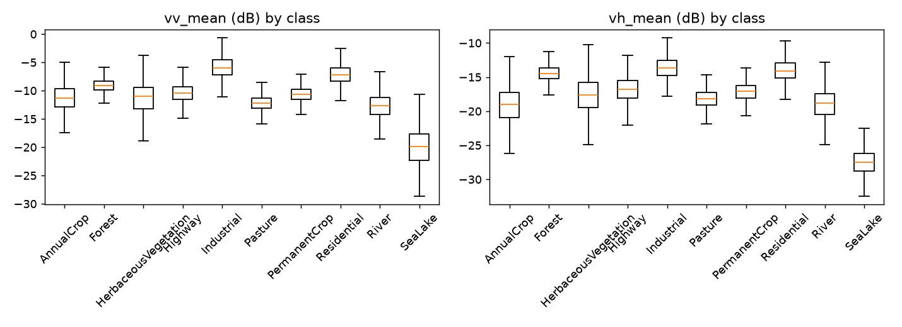
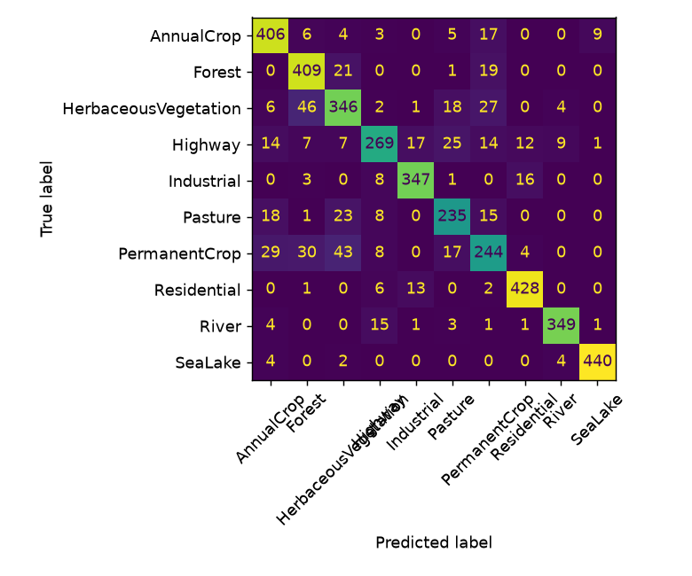

# Land-Cover Classification from Sentinel-1 SAR


Pipeline for Sentinel-1 radar (VV/VH) patches: speckle filtering, SAR feature engineering, statistical analysis, Random Forest with a polarisation ablation, and a Keras CNN. Companion to [sentinel2-landcover](https://github.com/Himanshuraj884/sentinel2-landcover).

## Pipeline

| Stage | Code | Methods |
|---|---|---|
| Data | `src/data.py` | Folder loader (`.npy`, GeoTIFF), scene-aware split |
| Preprocessing | `src/sar.py` | Lee speckle filter, dB conversion |
| Features | `src/sar.py` | 13 features: VV/VH statistics, VV-VH ratio, radar vegetation index, texture |
| EDA and statistics | `src/eda.py` | ANOVA, Kruskal-Wallis, eta-squared, PCA, K-Means (ARI, NMI) |
| Classical ML | `src/train_rf.py` | Random Forest, 5-fold CV, VV/VH ablation |
| Deep learning | `src/train_cnn.py` | Keras CNN, flips, early stopping |

The default `--split group` keeps every patch of a scene in the same part (train, validation or test) to limit spatial leakage. `--split random` is available for comparison.

## Usage

```
pip install -r requirements.txt

python run_all.py --data-dir data/sar --split group
python run_all.py --data-dir data/sar --split random
python run_all.py --synthetic --skip-cnn
python -m pytest tests
```

Flags: `--input-db`, `--max-per-class N`, `--no-despeckle`, `--skip-cnn`, `--epochs N`.
Outputs are written to `outputs/` (`figures/`, `reports/summary.json`, `reports/results.md`, `models/`). The `--synthetic` option generates fake data for testing the code only.

## Results

Dataset: EuroSAT-SAR (27,000 Sentinel-1 VV/VH patches, 64x64, 10 classes), 70/15/15 random split, single run (seed 0).

Split: **random** | patches: 27000 (train 18900 / val 4050 / test 4050)

| Model | Test accuracy | Macro-F1 | CV accuracy |
|---|---|---|---|
| Random Forest (13 SAR features) | 0.735 | 0.723 | 0.730 +/- 0.005 (StratifiedKFold(5)) |
| Keras CNN (VV, VH, ratio) | 0.858 | 0.852 | - |

Polarisation ablation (RF test accuracy):

| Features | Accuracy |
|---|---|
| VV only | 0.615 |
| VH only | 0.605 |
| VV + VH | 0.714 |
| all features | 0.735 |








Caveats: the patches have no scene identifiers, so a scene-level split was not possible. A random split can overstate accuracy through spatial autocorrelation. Band order (VV, VH) follows the dataset paper.

## Limitations

- Patch-level classification, one acquisition per location.
- No terrain correction beyond what the source data provides.
- A group split can leave a rare class thin in the test set, so check class counts.

## Environment

Tested with Python 3.13, TensorFlow 2.21, Keras 3.15, scikit-learn 1.9.

## License

MIT


## Reproduce

Download EuroSAT-SAR (MIT licence) from https://huggingface.co/datasets/wangyi111/EuroSAT-SAR and unzip it into data/raw/, then run:

```
python run_all.py --data-dir data/raw/EuroSAT-SAR --input-db --split random
```

Values are already in dB and files carry no scene IDs, so the random split is used.
